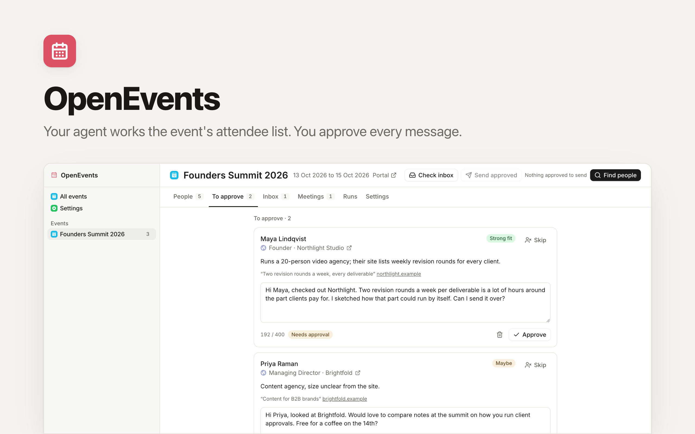
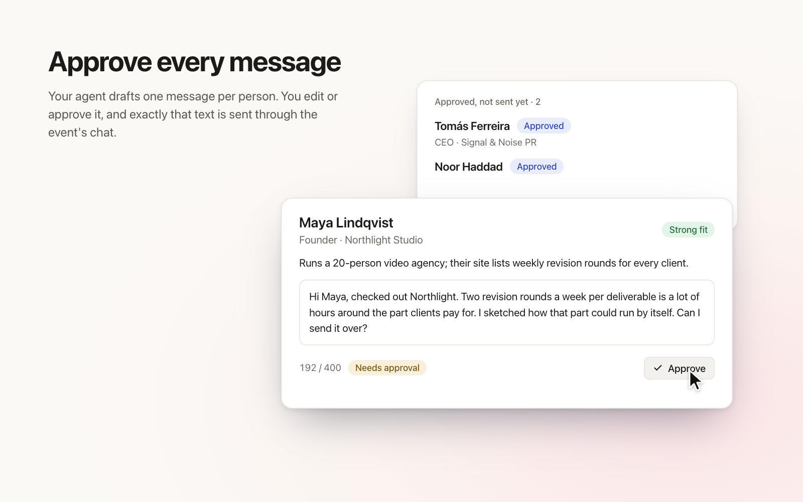
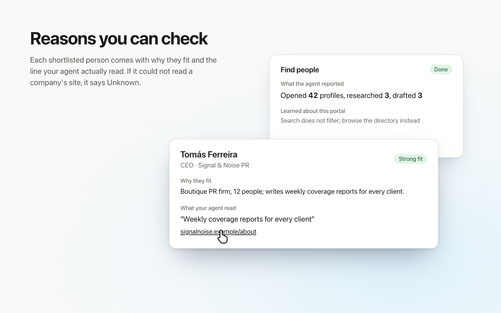
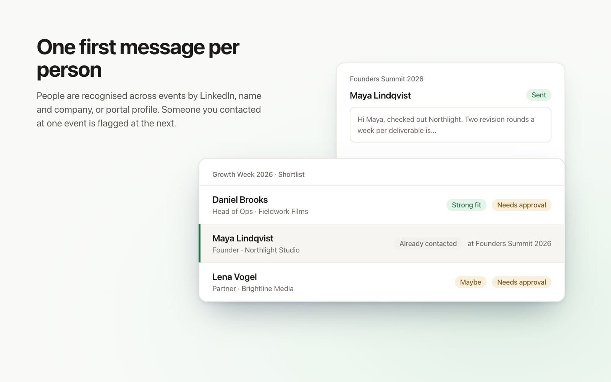
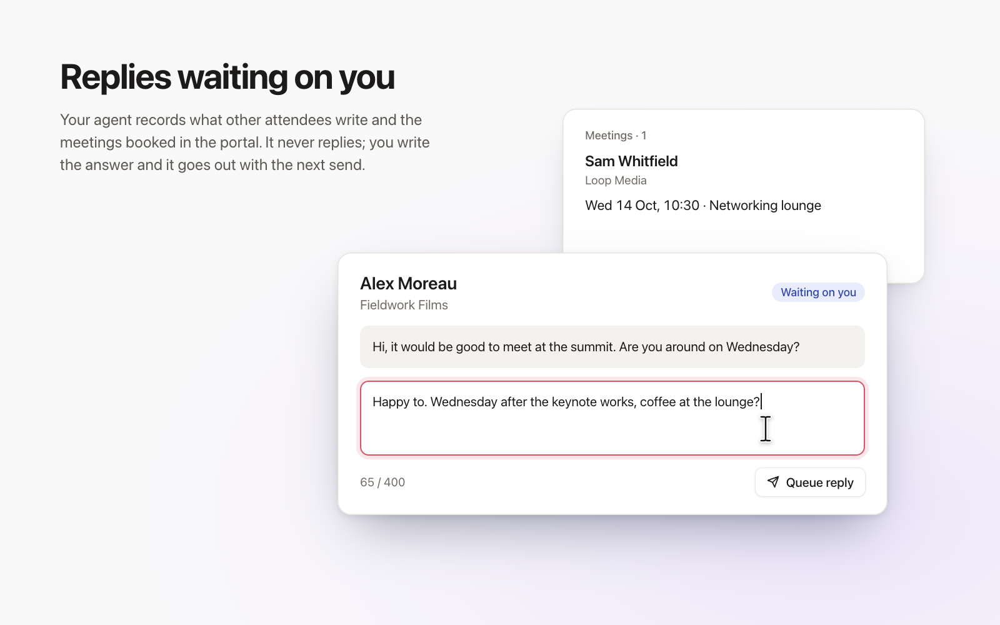

<picture>
  <source media="(prefers-color-scheme: dark)" srcset="readme-banner-dark.png" />
  
</picture>

# OpenEvents: Work an Event's Attendee List With Your Agent

[](https://app.clawnify.com/deploy?repo=clawnify/OpenEvents)

Your agent goes through a conference's attendee portal, shortlists the people worth meeting, researches each one and drafts a message. You approve every message, and the agent sends exactly what you approved through the event's own chat. An open-source app template provided by [Clawnify.com](https://clawnify.com).

Built with **React + Tailwind** on a **Hono API** and a **SQLite** database, with a full OpenAPI surface so an agent can drive it.

## See it in action

Conceptual UI illustrations of the app's main capabilities, with fictional example data. Open an image to see the details.

| Approve every message | Reasons you can check |
|---|---|
| [](previews/approve.png) | [](previews/evidence.png) |
| **One first message per person** | **Replies waiting on you** |
| [](previews/dedupe.png) | [](previews/inbox.png) |

## What it does

Most events put their attendee directory and a chat inside a portal or an app. Working it by hand takes hours: open profiles, check who they are, look at their company, write something that isn't a template, keep track of who answered. OpenEvents splits that work:

- **Your agent does the legwork** in its own browser, logged in as you: browsing the directory, reading company sites, drafting, sending, reading replies.
- **You keep the judgement.** Nothing goes out until you approve it, and the app enforces that on the server: an agent can't approve its own drafts or change their text.
- **The app keeps the record.** Who was shortlisted and why, the evidence behind each draft, what was sent, who replied, which meetings were booked.

It works with any event platform the agent can open in a browser, because it uses the event's own portal rather than an integration with one vendor.

## How it works

1. **Add an event:** its attendee portal, the dates, and who you want to meet. What you offer comes from your Company Knowledge on Clawnify, or you write it per event.
2. **Find people.** Your agent opens profiles one at a time, up to the limits you set. It researches the ones that fit and drafts a message for each. Every reason it gives quotes something it actually read; if it couldn't read a company's site, it says Unknown.
3. **Approve.** Edit any draft, then approve or skip it. Drafts longer than the portal allows can't be approved until they fit.
4. **Send approved.** Your agent sends each approved message word for word. If someone wrote to you in the meantime, it holds the message back and records their reply instead.
5. **Check inbox.** Your agent records new messages and booked meetings. Anyone waiting on you shows up in the Inbox, where your replies go out with the next send.

People are recognised across events by their LinkedIn profile, their name and company domain, or their portal profile. Someone you contacted at one event is flagged at the next one, and nobody gets a second first message.

## What it deliberately doesn't do

- **It doesn't copy the attendee directory.** The agent reads profiles one at a time as a logged-in attendee, within per-run limits. Exporting a whole directory into an outreach tool is the kind of event outreach attendees complain about.
- **It doesn't keep your login.** By default you sign in to the portal once, through your agent's browser, and the agent stops and tells you whenever it hits a login page. To let it sign back in on its own, add an `EVENT_PORTAL_LOGINS` environment variable in your workspace settings, JSON keyed by the portal's host: `{"portal.example.com": {"email": "you@company.com", "ticket": "12345678"}}`. The agent reads it only on that portal's login page. It still sees the values while typing them, so use this for event tickets, not for passwords you use anywhere else.
- **It doesn't reply on its own,** even to messages it reads during an inbox check.

## Running it

On Clawnify, deploy it with the button above, choose which agent works the portals in **Settings**, and sign in to your event's portal once in that agent's browser.

Locally:

```bash
pnpm install
pnpm dev          # UI on :5173, API on :8790
pnpm test         # API tests against an in-memory SQLite database
```

Outside Clawnify there is no agent connection, so each run gives you an instruction to paste into your agent's chat. The instruction contains the full procedure and the ids it works on.

## The agent procedures

Each run carries its own procedure, versioned in [`skills/`](skills/):

| Run | Skill | What the agent may do |
|---|---|---|
| Find people | [`event-shortlist`](skills/event-shortlist/SKILL.md) | Browse, research, draft. Never send. |
| Send approved | [`event-send`](skills/event-send/SKILL.md) | Send approved messages word for word. Never write or edit. |
| Check inbox | [`event-inbox`](skills/event-inbox/SKILL.md) | Read and record. Never reply. |

`pnpm build` embeds them into the app, so a run always carries the procedure the app was built with. Nothing is installed on the agent.

## License

MIT
